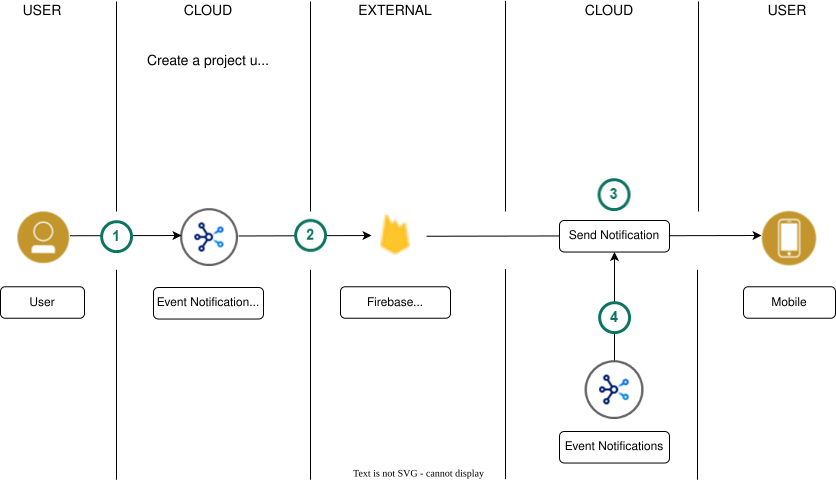
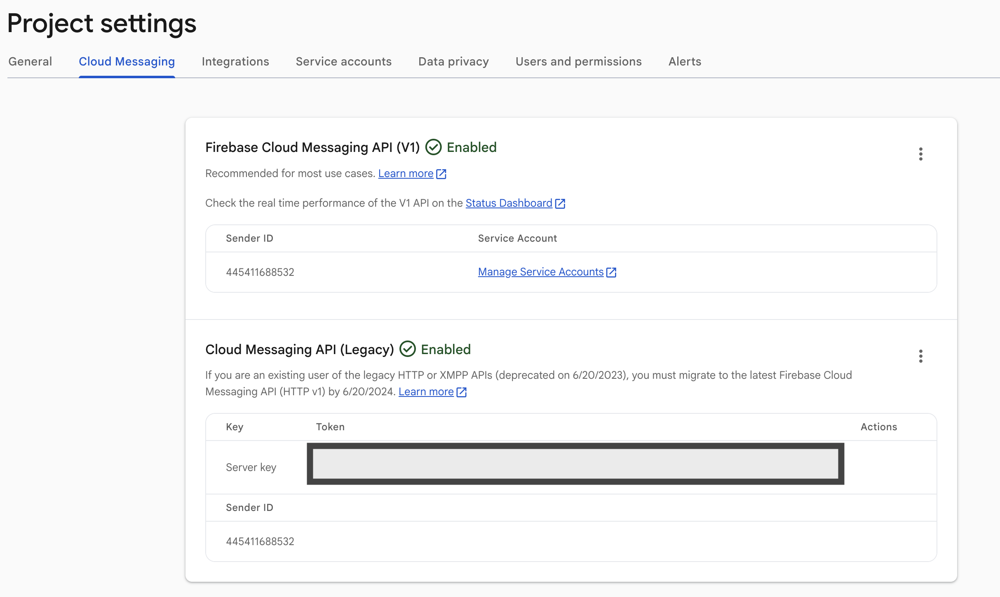
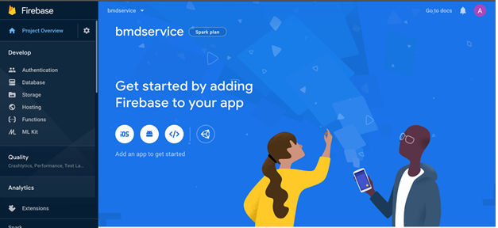
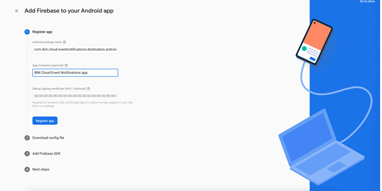
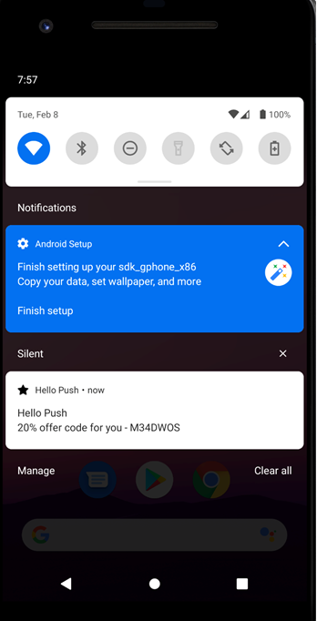
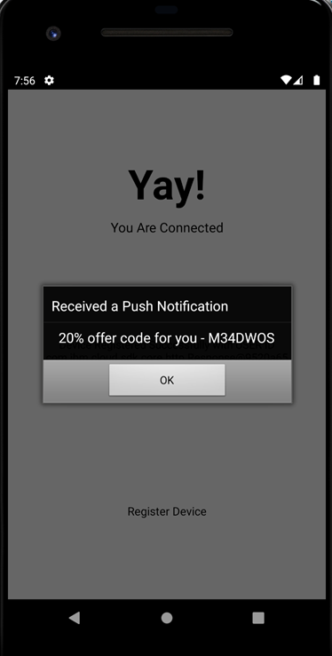

---

copyright:
  years: 2022, 2026
lastupdated: "2026-10-10"

keywords: event-notifications, event notifications, about event notifications, destinations, push

subcollection: event-notifications

---

{{site.data.keyword.attribute-definition-list}}

# Creating and sending push notifications to Android mobile using {{site.data.keyword.en_short}}
{: #en-push-fcm}

Create an {{site.data.keyword.en_short}} service, add a push destination for Firebase Cloud Messaging (FCM), and send messages to Android devices.
{: shortdesc}

## What is {{site.data.keyword.en_short}}?
{: #en-what-is-fcm}

{{site.data.keyword.en_short}} is an event notification routing service that notifies you of critical events that occur in your {{site.data.keyword.cloud_notm}} account or triggers automated actions by using webhooks. You can filter and route event notifications from {{site.data.keyword.cloud_notm}} services like {{site.data.keyword.prf_hubshort}}, to email, SMS, push notifications, and webhooks.

## How do clients use Android push notifications?
{: #en-how-clients-send-fcm}

The following diagram shows you how clients use Android push notifications.

{: caption="How clients use push notifications" caption-side="bottom"}

## Objectives
{: #en-objectives-fcm}

This tutorial shows you how to send push notifications as follows:

* Create a mobile app with {{site.data.keyword.en_short}}.
* Get FCM credentials.
* Download the code and complete the notifications setup.
* Configure and send Android push notifications to a mobile device.

## Before you begin
{: #en-before-begin-fcm}

You must have the following prerequisites in place:

* Download and install [Android Studio](https://developer.android.com/studio/index.html){: external} so that you can import and enhance your code.
* A Google account to log in to Firebase console to get your `project_id`, `private_key`, and `client_email`.
* An {{site.data.keyword.cloud_notm}} account. If you do not have one, [create an {{site.data.keyword.cloud_notm}} account](https://cloud.ibm.com/){: external}.

The instructions in this topic use FCM's HTTP v1 API. The HTTP v1 API has advantages such as secure access tokens, efficient customizations, and more extendable client platform versions. For more information about migrating from the FCM legacy HTTP API to the HTTP v1 API, see [Migrating FCM legacy HTTP API to HTTP v1 API](#en-fcm-http-migration).
{: important}

## Create an {{site.data.keyword.en_short}} service instance
{: #en-create-event-fcm}
{: step}

1. Log in to your [{{site.data.keyword.cloud_notm}} account](https://cloud.ibm.com/).
1. In the [{{site.data.keyword.cloud_notm}} catalog](https://cloud.ibm.com/catalog#services), search and select **Event Notifications > Event Notifications**.
1. Select a **Region** from the list of supported regions and select a **pricing plan**.
1. Provide a **Service name**.
1. Select a **resource group**.
1. Accept the licensing agreements and terms by clicking the checkbox.
1. Click **Create**.

## Get FCM credentials
{: #en-get-fcm}
{: step}

Firebase Cloud Messaging (FCM) is the gateway that delivers push notifications to Android devices. To set up the Android Push destination on the console, you must get your FCM credentials `project_id`, `private_key`, and `client_email`.

1. Go to the [Firebase Console](https://console.firebase.google.com/?pli=1){: external}. A Google user account is required.
1. Click **Create a project**. If you already have a project, click **Add Project**.
1. In the **Create a project** window, enter a project name, accept the terms, and enable or disable Google analytics (optional) by selecting the toggle switch, then click **Continue**.
1. If Google analytics is enabled, in the **Configure Google Analytics** window, choose the **Analytics location**, and accept the terms.
1. Click **Create Project**.
1. Click **Continue** when the new project is ready.
1. In the navigation panel, select the **Settings** icon next to **Project Overview** and select **Settings** > **Project settings**.
1. Click the **Service Accounts** tab.

   {: caption="FCM credentials" caption-side="bottom"}

1. Click **Generate new private key** to generate your project credentials. The downloaded file contains `project_id`, `private_key`, and `client_email`.

## Generate `google-services.json`
{: #en-gen-google-services}
{: step}

You also need to generate the `google-services.json` file. Complete the following steps:

* In the Firebase console Project overview section, under the **Get started by adding Firebase to your app** section, click the **Android** icon.

   {: caption="Firebase getting started" caption-side="bottom"}

* In the **Add Firebase to your Android app** window, add `com.ibm.cloud.eventnotifications.destination.android` as the Package Name. The **App nickname** field is optional.

* Click **Register app**.

   {: caption="Add Firebase to your Android app" caption-side="bottom"}

* Include the package name of your application. Enter the package name in the **Add Firebase to your Android app** window. The **App nickname** field is optional.

* Click **Register app**. See the following example:

   {: caption="Register Android app" caption-side="bottom"}

* The `google-services.json` file is generated.

* Download the latest config file `google-services.json` under Your apps.

## Add a generic API source
{: #en-add-gen-api-fcm}
{: step}

To create a generic API source:

1. Click **Sources** in the {{site.data.keyword.en_short}} instance.
1. Click **Create** and select an API Source in the **Create source** dialog.
1. Type a name and an optional description and click **Create source**.

## Create an {{site.data.keyword.en_short}} destination
{: #en-create-dest-fcm}
{: step}

Click **Destinations** in the {{site.data.keyword.en_short}} instance and click **Create**.

Enter the following destination details in the **Create destination** dialog.

* **Name**: add a name for the Destination.
* **Description**: add an optional description for the destination.
* **Type**: select **Android Push Notifications (FCM)** type from the dropdown list.
* Select a destination plan: Pre-production destination or Production destination.
   - **Pre-production destination** - select this destination as low-cost push destination, for your development and test environments.
   - **Production destination** - use the full capability of this destination. Unlimited devices and outbound messages allowed.
* Update the FCM Push Credentials with the `project_id`, `private_key`, and `client_email` from the file downloaded earlier.
* Click **Create destination**.

## Create an {{site.data.keyword.en_short}} topic
{: #en-create-topic-fcm}
{: step}

Click **Topics** in the {{site.data.keyword.en_short}} instance and click **Create**. Enter the following topic and filter details in the **Topic details** and **Event filters** steps:

* **Name**: enter a name for the topic.
* **Description**: add an optional description for the topic.
* **Source**: select a source from the dropdown list.
* **Event type**: select event type from the dropdown list.
* **Event sub type**: select event sub type from the event sub type dropdown list.
* **Severity**: select severity from the severity dropdown list.
* **Advanced conditions**: write your own custom conditions, which must follow [jsonpath specifications](https://www.rfc-editor.org/rfc/rfc9535.html). Jsonpath expressions can be validated at [jsonpath.com](https://jsonpath.com) or [extendsclass.com](https://extendsclass.com/jsonpath-tester.html).

## Create an {{site.data.keyword.en_short}} subscription
{: #en-create-sub-fcm}
{: step}

Proceed to the **Subscriptions** step. Click **Create** and enter the following subscription details in the **Create subscription** dialog.

* **Subscription name**: enter a name for the subscription.
* **Destination type**: select destination type.
* **Destination**: select destination.

Click **Create subscription**.

## Set up {{site.data.keyword.en_short}} Android SDK
{: #en-setup-android-sdk}
{: step}

The Android SDK enables Android apps to receive push notifications. Complete the following steps to install {{site.data.keyword.en_short}} Android SDK, initialize the SDK, and register for notifications for your Android app.

1. Install {{site.data.keyword.en_short}} by using Gradle.

   ```gradle
   compile 'com.ibm.cloud:eventnotifications-destination-android:0.0.1'
   ```
   {: codeblock}

1. Follow [event-notifications-destination-android-sdk](https://github.com/IBM/event-notifications-destination-android-sdk){: external} to install the SDK.

1. When Gradle is installed, [import and initialize](https://github.com/IBM/event-notifications-destination-android-sdk#initialize-sdk){: external} the SDK.

   ```java
   import com.ibm.cloud.eventnotifications.destination.android.ENPush;

   String instanceGUID = "<instance_guid>>";
   String destinationID = "<instance_destination_id>";
   String apiKey = "<instance_apikey>";

   ENPush enPush = ENPush.getInstance();
   enPush.setCloudRegion(ENPush.REGION_US_SOUTH); // Set your region

   enPush.initialize(getApplicationContext(),instanceGUID,destinationID, apiKey);
   ```
   {: codeblock}

1. When the SDK is initialized, [register](https://github.com/IBM/event-notifications-destination-android-sdk#register-for-notifications){: external} for push notifications.

   ```java
   // Register the device to Event Notifications
   enPush.registerDeviceWithUserId("userId",new ENPushResponseListener<String>() {

      @Override
      public void onSuccess(String deviceId) {
         //handle successful device registration here
      }

      @Override
      public void onFailure(ENPushException ex) {
         //handle failure in device registration here
      }
   });
   ```
   {: codeblock}

1. Optionally, you can also create a push tag subscription. The [subscribeToPushTag](https://github.com/IBM/event-notifications-destination-android-sdk#subscribe-to-tags){: external} API subscribes the device for a particular tag. After the device is subscribed to a particular tag, the device can receive notifications that are sent for that tag. Add the following code snippet to your Android mobile application to subscribe to a list of tags.

   ```java
   // Subscribe to the given tag, if tagname is not available it will first get create then push device will get subscribe to it.
   enPush.subscribe(tagName, new ENPushResponseListener<String>() {

      @Override
      public void onSuccess(String arg) {
         System.out.println("Succesfully Subscribed to: "+ arg);
      }

      @Override
      public void onFailure(ENPushException ex) {
         System.out.println("Error subscribing to Tag1.." + ex.getMessage());
      }
   });
   ```
   {: codeblock}

1. Add the notifications listener for receiving the notification in your application.

   ```java
   //Handles the notification when it arrives
   ENPushNotificationListener notificationListener = new ENPushNotificationListener() {

      @Override
      public void onReceive (final ENSimplePushNotification message){
         // Handle Push Notification
      }
   };
   ```
   {: codeblock}

   ```java
   if(enPush != null) {
      enPush.listen(notificationListener);
   }
   ```
   {: codeblock}

1. When the setup is complete, run your application and register for push notifications.

## Send notifications to the Android device
{: #en-send-notifications-fcm}
{: step}

Use the [Send notification API](/docs/apis/event-notifications) to send the push notification for the Android device. You can use the [Node](https://github.com/IBM/event-notifications-node-admin-sdk#send-notifications){: external} or [Go](https://github.com/IBM/event-notifications-go-admin-sdk#send-notifications){: external} admin SDK instead of calling the API directly.

{: caption="Send notifications" caption-side="bottom"}

{: caption="Receive notifications" caption-side="bottom"}

## Migrating FCM legacy HTTP API to HTTP v1 API
{: #en-fcm-http-migration}

Apps that use the FCM legacy HTTP API should consider migrating to the HTTP v1 API by using the instructions in this section. The HTTP v1 API has advantages such as secure access tokens, efficient customizations, and more extendable client platform versions.

In {{site.data.keyword.en_short}}, you can create an Android destination by following FCM norms. For the legacy HTTP API, support is provided through two required parameters: `server_key` and `sender_id`. For the v1 HTTP API, FCM introduced three new parameters: `project_id`, `client_email`, and `private_key`. Both legacy and v1 HTTP APIs are mutually exclusive.

Complete the following steps to migrate from an old configuration to a new one.

1. Under your existing FCM Android destination configuration, find `server_key` and `sender_id`. Update the existing destination by providing `project_id`, `client_email`, and `private_key` by using the PATCH /destinations/{id} API call.

   Existing Android destination configuration:

   ```javascript
   {
      "name": "Existing android destination",
      "description": "Android destination with legacy parameters",
      "type": "push_android",
      "config": {
         "params": {
            "sender_id": "xxxxxx",
            "server_key": "xxxxxx"
         }
      }
   }
   ```
   {: codeblock}

   New Android destination configuration:

   ```javascript
   {
      "name": "New android destination",
      "description": "Android destination with V1 HTTP parameters",
      "type": "push_android",
      "config": {
         "params": {
            "project_id": "xxxxx",
            "private_key": "xxxxx",
            "client_email": "abc@xyz.pqr"
         }
      }
   }
   ```
   {: codeblock}

### Examples of FCM payload changes
{: #en-fcm-http-migration-payload-example}

* FCM Legacy HTTP API

   ```javascript
   {
      "notification": {
      "title": "Incidunt qui porro sequi iste assumenda esse animi.",
      "body": "Minus reprehenderit ut nisi. Aut earum qui est iure eos fuga."
      },
      "data": {
         "name": "Willie Greenholt",
         "description": "Voluptas voluptatem sed quia expedita error a at sit rerum. Numquam unde debitis incidunt qui impedit et necessitatibus. Cupiditate exercitationem enim ut laborum itaque et."
      }
   }
   ```
   {: codeblock}

* FCM HTTP v1 API

   ```javascript
   {
      "message": {
         "android": {
            "notification": {
               "title": "Incidunt qui porro sequi iste assumenda esse animi.",
               "body": "Minus reprehenderit ut nisi. Aut earum qui est iure eos fuga."
            },
            "data": {
               "name": "Willie Greenholt",
               "description": "Voluptas voluptatem sed quia expedita error a at sit rerum. Numquam unde debitis incidunt qui impedit et necessitatibus. Cupiditate exercitationem enim ut laborum itaque et."
            }
         }
      }
   }
   ```
   {: codeblock}
